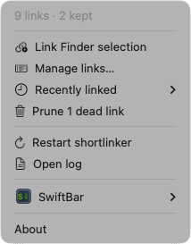

# shortlinker

Self-hosted, tailnet-only short links. Paste `https://<hub>.<tailnet>.ts.net/budget`
into Notion or anywhere else; clicking it opens app deep links (`obsidian://…`)
on Mac and iOS, opens files and folders on whichever Mac you clicked, and
serves them to phones. One Go binary, no dependencies, nothing leaves your
Tailscale network.

## Set it up with your agent

[`skills/any-device-files`](skills/any-device-files/SKILL.md) is a guide a coding
agent follows to set up shortlinker with Tailscale and SilverBullet. Then everything
your agent makes (screenshots, videos, PDFs, Markdown, code) opens on your laptop or
your phone, and you can edit Markdown and code from the phone. Tell your agent:

    Follow https://github.com/loschenbd/shortlinker/blob/main/skills/any-device-files/SKILL.md

Or copy the folder into `~/.claude/skills/` for Claude Code. It asks before each
install and leaves every sign-in and password to you.

## Install

**Hub (the designated, usually-awake Mac):**

    make install
    # One-time: publish the hub at https://<hub>.<tailnet>.ts.net.
    # This replaces whatever this Mac already serves at / on port 443.
    tailscale serve --bg --https=443 http://127.0.0.1:7777

The hub listens on two loopback ports. **7777** is the public one: `tailscale
serve` publishes it, and it holds the short links and file serving. **7778**
opens files on this Mac and holds the link API and the manage page. Never
publish 7778.

Recommended: System Settings → Battery/Energy → prevent sleep when plugged in.
Every link requires the hub to be awake.

**Every other Mac (opener agent):**

    HUB=https://<hub>.<tailnet>.ts.net make install

An agent listens only on 7778, to open files on its own Mac.

**Menu bar (optional, needs [SwiftBar](https://swiftbar.app)):**

    make swiftbar

See [Menu bar](#menu-bar).

## Links

Every link is a record in `~/.config/shortlinker/links.jsonl`: its slug,
its target, and what shortlinker knows about it. That covers when it was
made, by which agent session, in which project, a note, and how often it's
been clicked. A target with `://` is a redirect (`https://…`,
`obsidian://daily?vault=Main`); anything else is a file or folder path.
Slugs are lowercase letters, digits and hyphens; `o`, `f` and `api` are
reserved.

**Kept links** are the ones you mean to keep: links you named yourself, and
any you mark with **Keep forever** in the manage page or `shortlinker keep`.
They never archive, and `prune` leaves them alone. Every other link is one
sl-link made, which archives when nobody uses it (see
[What shortlinker records](#what-shortlinker-records)).

You manage links with the [manage page](#manage-page), the
[commands](#commands) or the [API](#api), not by editing the file. The hub
re-reads it if it changes on disk, and the format is one JSON object per
line, but the hub writes it too. For a file you can edit, keep in git, or
move to another Mac, use the text format:

    shortlinker export > links.txt    # slug = target | phone page, notes as comments
    shortlinker import links.txt      # adds them as kept links

```
# slug = target | phone page (optional)
budget = ~/Documents/Finance/2026-budget.numbers
daily  = obsidian://daily?vault=Main
# A comment right above a link is its note.
proj   = ~/Code/my-app
```

## A link for any file: `sl-link`

    sl-link ~/Documents/report.pdf docs/notes.md
    # https://<hub>.<tailnet>.ts.net/report-pdf
    # https://<hub>.<tailnet>.ts.net/notes-md

Prints one link per file or folder, registering it if it's new. Run it on the
hub Mac. The slug is the file's name (`report-pdf`); when that's taken it
tries the folder plus the name (`documents-report-pdf`), then `-2`, `-3`.
Linking the same path again prints the same link. The link works in anything
that opens web links: a Mac opens the file, a phone shows it. That makes it a
good replacement for `file://` links, which many apps don't open.

- Exit codes: 0 ok, 1 error, 2 no such path, 4 hub unreachable.
- `--finder` adds `?finder`: a Mac shows the file in Finder instead of opening
  it; a phone treats it like the plain link.
- `--markdown` prints `[report.pdf](https://…/report-pdf)`.
- `--copy` also copies the links; `--selection` links what's selected in
  Finder.
- `--note "why"` saves a note with a new link, shown in the manage page.
- sl-link records which agent session made a link, from `SHORTLINKER_SESSION`
  or Claude Code's `CLAUDE_CODE_SESSION_ID`, so you can find the
  conversation it came from.
- The address it prints comes from `SHORTLINKER_URL`, else
  `~/.config/shortlinker/url`. The first run fills that file in from this
  Mac's tailnet name, which takes several seconds once: the macOS `tailscale`
  CLI starts the whole app on every call. If the Mac's tailnet name changes,
  delete the file.
- `sl-link` is a symlink to the binary; `shortlinker link <path>` does the
  same.

**Phone pages for Markdown and code.** A phone opening a Markdown or code
link gets plain text, unless the link has a phone page: a URL where the file
can be read or edited, such as a SilverBullet page. Code here means source
and text files such as `.go`, `.py`, `.ts`, `.sh`, `.json`, `.yaml` and
`.txt` (the list is `phonePageExts` in `phone.go`). HTML is left out, because
on a phone it should render. sl-link asks the hub for one, and the hub runs
`sb-link` (or the command in its `SHORTLINKER_PHONE_CMD`) with the file's
path, once, and saves what it prints with the link:

    notes-md = ~/Documents/notes.md | https://<hub>.<tailnet>.ts.net:3000/notes

The command should print the URL and exit 0, or exit non-zero with the reason
on stderr; only exit 0 counts. Without such a command on the hub nothing
changes. When the command declines, sl-link says why on stderr and the link
still works. Running sl-link on the file again fills in a missing page, and
`shortlinker phone-pages` fills in every link's. The
page can also be set through the API: `POST /api/links/<slug>/phone
{"url": "https://..."}`.

## Commands

All run on the hub Mac.

    shortlinker ls [words...]     # list links, or those matching every word
    shortlinker ls --unclicked --older 14 --project my-app
    shortlinker ls --kept         # only kept links
    shortlinker ls --archived     # include archived links (--removed: tombstones)
    shortlinker keep <slug>...    # keep links (unkeep: stop keeping them)
    shortlinker note <slug> text  # set a link's note (--clear removes it)
    shortlinker rm <slug>...      # delete links
    shortlinker mv <old> <new>    # rename and keep (the old address sends clicks on)
    shortlinker archive <slug>... # hide links from the lists
    shortlinker restore <slug>... # bring them back
    shortlinker copy <slug>       # copy a link (--markdown for [name](link))
    shortlinker manage            # open the manage page
    shortlinker prune -n          # list links that aren't kept whose file is gone
    shortlinker prune             # remove them
    shortlinker phone-pages       # make missing phone pages (Markdown, code)
    shortlinker export            # every link in the text format
    shortlinker import [file]     # add links from that format, kept

`prune` never touches kept links. A removed link's slug is never given to
another file: an old link shows "This link was removed", never someone
else's file. Linking the same file again brings its old link back.

## What shortlinker records

For each link: when it was made, how (`sl-link`, `finder`, `api`, `manage`
or `import`), the git project its file is in (the main checkout, even for a
file in a worktree), the agent session that made it, an optional note, how
many times sl-link printed it, its clicks, and the device of the last one.

Each click on a short link goes in `clicks.jsonl`: the time, the slug, which
tailnet device clicked (Tailscale names it), whether it was a Mac or a phone,
what the click did, and the referring site's origin (`https://www.notion.so`,
never the full URL). Only slugs that could exist are logged, and the log
moves to `clicks.jsonl.1` at 10 MB, replacing the one before, so a flood of
requests can't fill the disk.

**Archiving.** A link that isn't kept and that nobody clicks within 30 days
of being made, or that goes 180 days without a click, is archived: it's
hidden from `ls`, the manage page and the menu, but it still works, and a
click or linking the file again brings it back. The hub checks once an hour.

DuckDB reads both files directly, for questions like how many links get
clicked at all:

    duckdb -c "SELECT route, count(*) FROM read_json('~/.config/shortlinker/clicks.jsonl') GROUP BY route"

See [the design](docs/superpowers/specs/2026-11-19-link-records-design.md)
for what's recorded and why, and what deliberately isn't.

## Manage page

`shortlinker manage` (or **Manage links…** in the menu) opens a page on the
hub with every link and its record: filter by kept, never clicked, archived,
missing or removed, search, sort, and see each link's clicks, project, note
and the session that made it (with a `claude --resume` command to copy).
From there you can keep, archive, restore, rename, edit, note and delete
links, and prune dead ones. It works only on the hub Mac, in that browser,
for 12 hours; open it again from the menu or the command after that.

## Menu bar



`make swiftbar` adds a SwiftBar plugin with:

- **Link Finder selection**: links what's selected in Finder and copies the
  link. The first time, macOS asks to let SwiftBar control Finder.
- **Manage links…**: the manage page.
- **Recently linked**: what sl-link linked last; click to copy, hold Option
  to copy as Markdown.
- **Prune N dead links**, when there are any; restart and log.

The plugin is two lines around `shortlinker swiftbar`. To show the menu inside
another plugin instead of as its own icon, run `shortlinker swiftbar --nested`
there and put `--` in front of each line for each level down.

## API

The link API answers only on the hub Mac (port 7778) and needs the hub's
token, which the hub writes to `~/.config/shortlinker/token` on first start:

    TOKEN=$(cat ~/.config/shortlinker/token)
    curl -H "Authorization: Bearer $TOKEN" http://127.0.0.1:7778/api/links
    curl -H "Authorization: Bearer $TOKEN" 'http://127.0.0.1:7778/api/links?details=1'
    curl -X POST -H "Authorization: Bearer $TOKEN" -H 'Content-Type: application/json' \
      -d '{"slug":"budget","target":"~/Documents/Finance/2026-budget.numbers"}' \
      http://127.0.0.1:7778/api/links
    curl -X POST -H "Authorization: Bearer $TOKEN" -H 'Content-Type: application/json' \
      -d '{"target":"~/Documents/report.pdf"}' http://127.0.0.1:7778/api/links
    # {"created":true,"phone":"","slug":"report-pdf","target":"~/Documents/report.pdf"}
    curl -X DELETE -H "Authorization: Bearer $TOKEN" http://127.0.0.1:7778/api/links/budget

A POST with a slug makes or replaces a kept link (it also takes `phone`).
Leaving out the slug, as in the second POST, does what sl-link does. Both
take `origin`, `session` and `note`. Also:

- `GET /api/links?details=1&archived=1&removed=1`: every link with its record
- `GET /api/links/<slug>/clicks`: a link's clicks, newest first
- `GET /api/stats`: counts, and the last 30 days of clicks by device and site
- `POST /api/links/<slug>/keep {"kept": true}` (or `false` to stop keeping it)
- `POST /api/links/<slug>/note {"note": "..."}`
- `POST /api/links/<slug>/archive {"archived": true}` (or `false` to restore)
- `POST /api/links/<slug>/rename {"to": "new"}`
- `POST /api/links/<slug>/phone {"url": "..."}`
- `POST /api/links/<slug>/phone-page`: make a Markdown or code link's phone page
- `POST /api/prune {"dry_run": true}`

Delete the token file and restart the hub to change the token.

## How a click works

- Every click is logged (see [What shortlinker records](#what-shortlinker-records)).
- Deep link / URL target → 302 straight to the target (Mac + iOS).
- File/folder target → 302 to `http://localhost:7778/o/<slug>`, handled by
  the clicking Mac's own opener, which runs `open`. Apps, scripts, installers
  and other executable files are shown in Finder instead of opened.
  (Note: iPads using desktop-class Safari report a Mac user agent and will see
  a connection error instead.)
- File target with a phone page, on a phone → 302 to that page.
- `?finder` on a Mac → `http://localhost:7778/o/<slug>?reveal=1`, which shows
  the file in Finder.
- Any other file/folder target on a phone → 302 to `/f/<slug>`, where the hub
  serves the file itself (HTML renders, with `charset=utf-8`). A folder
  serves the files beneath it, `index.html` if there is one, or a listing.
  Markdown, scripts and other text files show as plain text. Any device can
  open `/f/<slug>` directly to read a file instead of opening it.
- Renamed link → 302 to its new slug. Removed link → 410, "This link was
  removed".

## Security model

- **Who can reach what.** Both ports bind `127.0.0.1` only. The sole network
  path in is `tailscale serve` (WireGuard-authenticated tailnet devices, never
  the public internet), and it only reaches port 7777. Loopback is shared by
  every account and process on the hub Mac, so they can reach both ports too.
- **Why two ports.** Every request through `tailscale serve` arrives from
  127.0.0.1 carrying whatever Host header the sender chose, so nothing on 7777
  can tell this Mac from another tailnet device. Opening files and changing
  links therefore live on 7778, which the tailnet can't reach.
- **The token.** Because other accounts and processes on the hub can reach
  7778, the link API needs the token in `~/.config/shortlinker/token`
  (readable by you only). Without it, anything on the Mac could register a
  path (say `~/.ssh/id_ed25519`) and read it back through `/f/`. Before
  sending it, every command checks that what answers on 7778 knows the token
  (an HMAC of a fresh nonce), so another account's server on that port while
  the hub is down gets nothing. The manage page never sees the token:
  `shortlinker manage` trades it for a one-time code, and the page trades
  that for a session that expires in 12 hours. The code reaches the browser
  through `osascript` on stdin, never as an argument, since every account
  can read every process's arguments.
- **Web pages.** 7778 refuses any Host but `localhost` and `127.0.0.1` (DNS
  rebinding), and its API refuses requests from other sites' pages (a
  `Sec-Fetch-Site` of `cross-site` or `same-site`) and bodies that aren't
  JSON. 7777 refuses any Host but loopback and this hub's own tailnet name
  (from its saved address or from Tailscale), so a rebinding page in a browser
  on the hub can't read files or ask what a slug points to.
- **Opening.** `open` only ever runs on targets of registered slugs, and only
  on full paths. Any web page can send your browser to
  `localhost:7778/o/<slug>`, so targets that would run code are shown in
  Finder rather than opened, judged by the link's name and by what a symlink
  points to. A request that isn't a navigation (`Sec-Fetch-Dest` other than
  `document`, as from an `` or `fetch()`) opens nothing.
- **Serving.** `/f/` serves only registered file/folder slugs, to any device
  on your tailnet (and any account on the hub). Inside a folder slug, `os.Root`
  refuses `..` and symlinks that leave the folder, and dot-paths (`.git`,
  `.env`) are never served or listed. A file link that's a symlink is served
  only if it points within its own folder, so linking a repository's
  `notes.txt -> ../../.ssh/id_ed25519` serves nothing. Nothing inside
  `~/.config/shortlinker` (the token, the records, the click log, backups) is
  ever served, whatever is linked, even `~/.config` itself; such links still
  open on this Mac. Every response carries `X-Content-Type-Options: nosniff`.
- **Phone pages.** `sb-link` reads SilverBullet's admin password from the
  login Keychain, which only processes your desktop login started can
  read. A terminal multiplexer started over SSH (as Moshi Desktop and
  phones start one) can't, and neither can anything running in it. So the
  hub, which launchd starts with your login, runs `sb-link`, one at a time
  and for at most 30 seconds. Agents can ask for a page; they never see
  the password.
- **Sandboxing.** Served pages share one origin, so a page that runs script
  could read every other served file. Every HTML, SVG and XML file is served
  with `Content-Security-Policy: sandbox`: its scripts run, but in an opaque
  origin with no storage. PDFs, images and text can't run script on this
  origin and aren't sandboxed.
- **Files.** `links.jsonl`, `clicks.jsonl` and the token are readable by you
  only, and `links.jsonl` is replaced atomically (temporary file, then
  rename), so a click during a save or a crash never sees half a file. Click
  counts are saved within 2 seconds, and when the hub stops; the click
  itself is in `clicks.jsonl` at once.
- **Terminal output.** File names can hold control characters, which could
  retitle a terminal or write its clipboard, so the commands print them
  escaped (`\x1b`). The menu replaces them with spaces.
- **Project detection** reads a `.git` file only if you own it and it's a
  small regular file, so a pipe someone plants at `/tmp/.git` can't hang the
  hub.
- **Click details are statistics, not proof.** The device comes from the
  `X-Forwarded-For` header `tailscale serve` adds, and anything on the hub Mac
  can send its own. Nothing uses it to decide access.

## Upgrading

The hub brings older layouts into `links.jsonl` when it starts, with every
slug, target and phone page unchanged, and keeps each old file as a backup:

- `links.txt`, where your links used to be, becomes kept records, with a
  comment right above a link as its note. It's kept as
  `links.txt.before-records`. If it still has sl-link's links at the end,
  under a `# Added by sl-link` line, those become ordinary records.
- `auto-links.jsonl`, sl-link's records, is kept as
  `auto-links.jsonl.before-merge`. Where a slug was in both files,
  `links.txt`'s target wins, as it did, and the record's history stays.
- `auto-links.txt`, sl-link's file before records, is kept as
  `auto-links.txt.before-records`.

Links that had no record are dated the day they move, so nothing archives
for 30 days, and your links get their clicks from `clicks.jsonl`.

## Troubleshooting

- Logs: `~/Library/Logs/shortlinker.log`
- Restart: `launchctl kickstart -k gui/$(id -u)/com.$(id -un).shortlinker`
- "hub unreachable — is it awake?": wake the hub Mac.
- `sl-link` exits 4: the hub isn't running on this Mac; check the log.
- "no hub token": run the command on the hub Mac; the hub writes the token
  when it starts.

## License

MIT. See [LICENSE](LICENSE).
